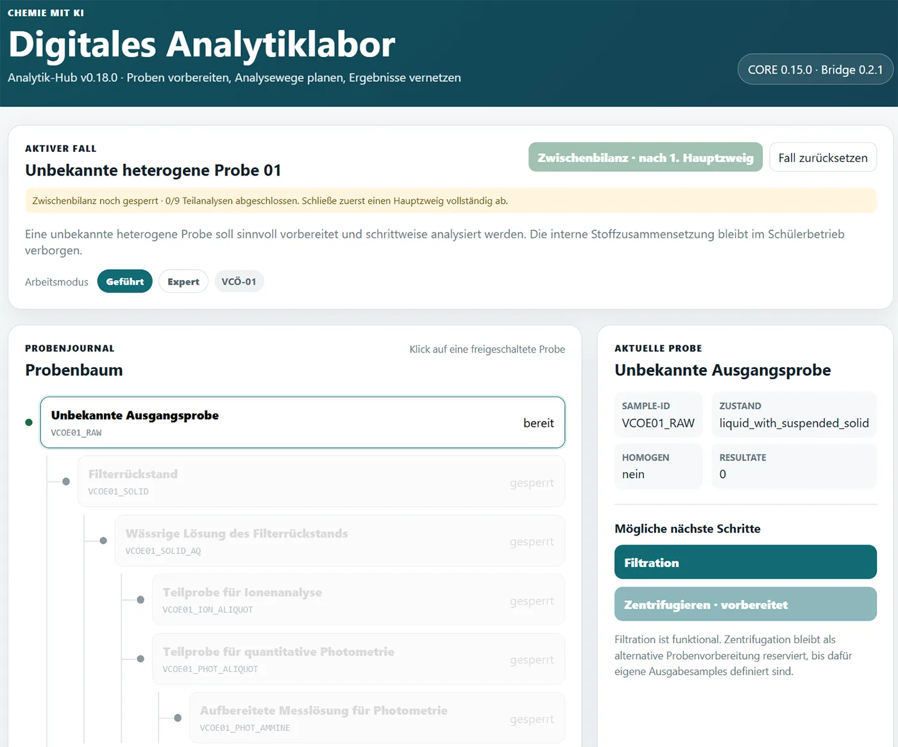
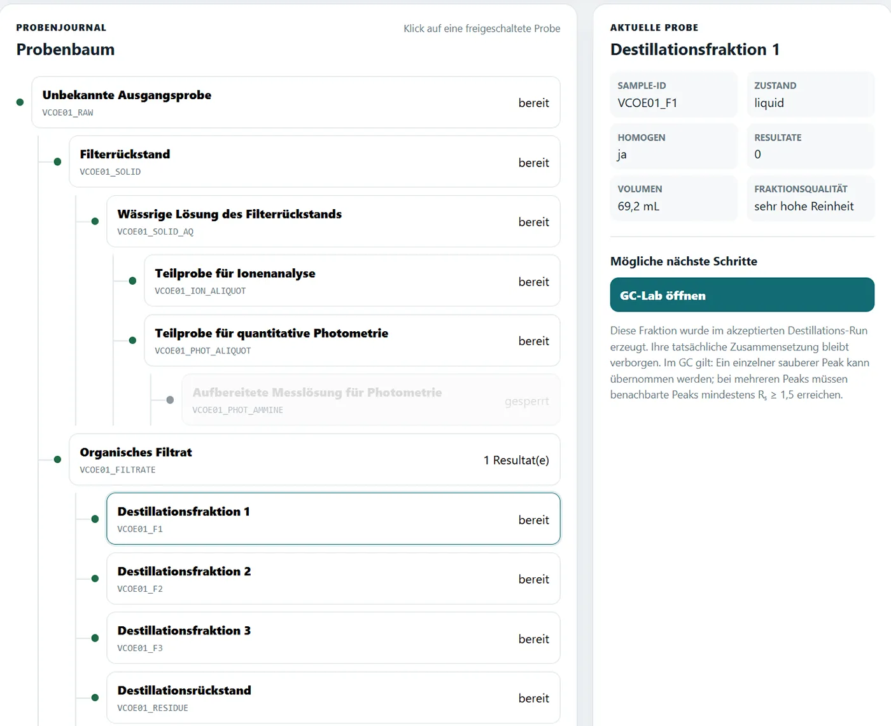
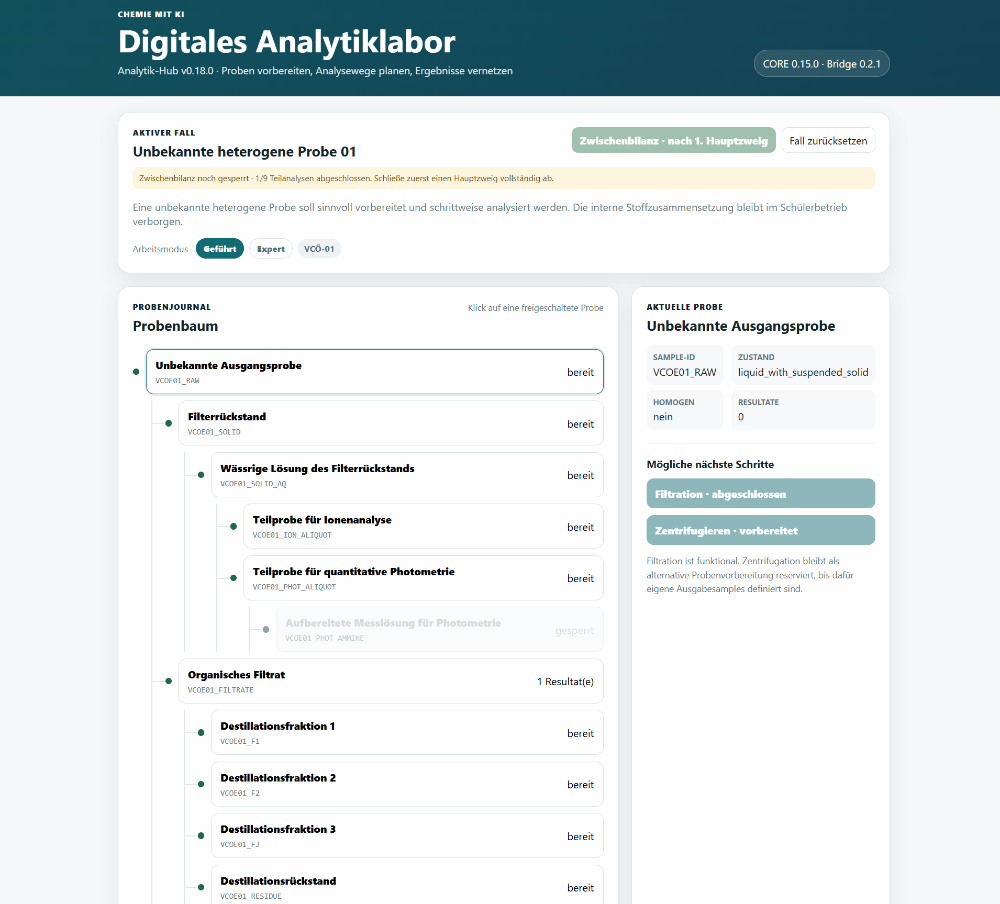
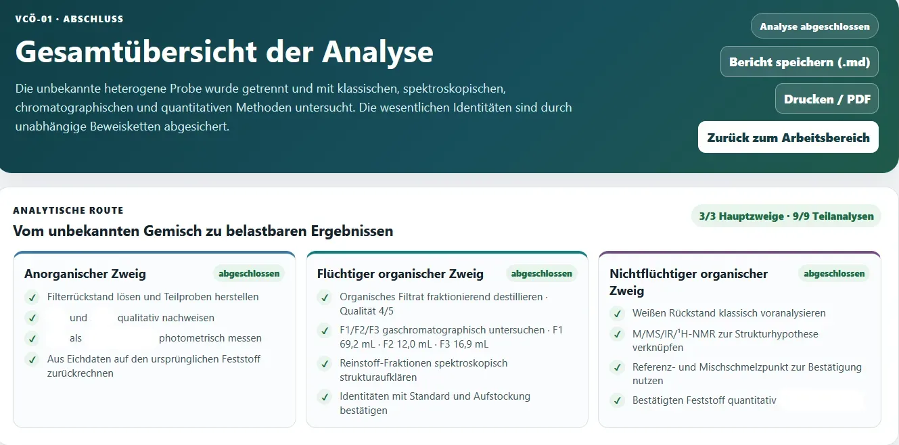

# Digitales Analytiklabor – eine Probe, viele vernetzte Analysewege

Das **Digitale Analytiklabor** verbindet mehrere browserbasierte Chemie-Apps zu einem gemeinsamen Analyseweg. Im Mittelpunkt steht nicht eine einzelne Messmethode, sondern eine **unbekannte Probe**, die schrittweise getrennt, untersucht und charakterisiert wird.

Der zentrale **Analytik-Hub** verwaltet dabei die Probe und ihre Teilproben, dokumentiert den bisherigen Arbeitsweg und übergibt konkrete Analyseaufträge an spezialisierte Detail-Labore. Deren Ergebnisse werden anschließend wieder in den Hub zurückgeführt und dort mit den bereits vorhandenen Befunden verknüpft.

[**Digitales Analytiklabor öffnen**](https://ekerzendorfer.github.io/CHEMIE_ANALYTIK_HUB/){ .md-button .md-button--primary }

[**Quellcode auf GitHub**](https://github.com/ekerzendorfer/CHEMIE_ANALYTIK_HUB){ .md-button }

*Startansicht des Analytik-Hubs: Die unbekannte Ausgangsprobe bildet den Ausgangspunkt für den gesamten Analyseweg.*

## Von der Einzelanwendung zum vernetzten Analyselabor

Viele virtuelle Chemie-Labore bilden jeweils einen klar abgegrenzten Arbeitsschritt ab: eine Titration, eine photometrische Messung, eine chromatographische Trennung oder die Auswertung spektroskopischer Daten.

Das Digitale Analytiklabor verfolgt einen anderen Ansatz.

Ausgangspunkt ist eine **unbekannte Probe**. Die Lernenden müssen entscheiden,

- welche Probenvorbereitung sinnvoll ist,
- welche Teilprobe für welche Untersuchung geeignet ist,
- welche Methode eine konkrete analytische Frage beantworten kann,
- welche Aussagen durch die bisherigen Daten tatsächlich abgesichert sind,
- und welche Untersuchungen noch fehlen.

Dabei entsteht schrittweise ein **Probenbaum**. Aus der Ausgangsprobe werden durch Filtration, Lösen, Destillation oder andere Aufbereitungsschritte neue Teilproben und Fraktionen, die anschließend mit unterschiedlichen Methoden weiter untersucht werden können.

!!! info "Didaktische Grundidee"
    Nicht die Bedienung einzelner Apps steht im Mittelpunkt, sondern das **Planen und Begründen eines vollständigen Analysewegs**. Die Lernenden sollen nachvollziehen, welche experimentelle Evidenz hinter einer Stoffidentifikation oder einer quantitativen Aussage steht.

*Der Probenbaum macht sichtbar, wie aus einer Ausgangsprobe Teilproben, Destillationsfraktionen und unterschiedliche Analysezweige entstehen.*

## Die Anwendungen arbeiten zusammen

Eine Besonderheit des Systems ist die direkte Zusammenarbeit mehrerer unabhängiger Webanwendungen.

Der Hub übergibt einer Detailanwendung einen **konkreten Analyseauftrag** mit den notwendigen Informationen zur ausgewählten Probe. Die Detail-App führt die Untersuchung durch und erzeugt anschließend ein strukturiertes digitales **RESULT**.

Dieses RESULT wird wieder an den Hub übergeben. Dort wird es

- der richtigen Probe zugeordnet,
- in das Laborjournal aufgenommen,
- für weitere Analyseschritte ausgewertet,
- und gegebenenfalls als Ausgangspunkt für einen neuen Auftrag verwendet.

So können beispielsweise Messdaten aus einem virtuellen Photometer anschließend im Daten-Lab quantitativ ausgewertet oder eine chromatographisch getrennte Fraktion zur Strukturaufklärung an ein Spektroskopie-Labor weitergereicht werden.

Die beteiligten Anwendungen bleiben trotzdem eigenständig und können weiterhin auch unabhängig vom Hub verwendet werden.

*Ein Analyseauftrag wird an eine Detail-App übergeben; das dort erzeugte RESULT kehrt anschließend in den Hub zurück und wird in den laufenden Fall integriert.*

## Keine analytische Blackbox

Ein zentrales Ziel des Projekts ist, digitale Werkzeuge **nicht zu Ergebnisautomaten** werden zu lassen.

Messwerte und simulierte Beobachtungen dürfen von einer Anwendung erzeugt werden. Die fachlich entscheidende Interpretation soll jedoch möglichst bei den Lernenden bleiben.

Bei einer photometrischen Analyse werden daher beispielsweise nicht einfach Konzentration und Masse ausgegeben. Eichdaten, Regression, Verdünnung und Stoffmengenrechnung müssen nachvollziehbar ausgewertet werden.

Auch ein Gaschromatogramm liefert zunächst Peaks und Retentionszeiten. Eine Stoffidentität gilt erst dann als gesichert, wenn weitere unabhängige Befunde diese Zuordnung stützen.

So entstehen im Laufe der Untersuchung **Beweisketten** statt isolierter Einzelergebnisse.

!!! tip "Ein hilfreicher Leitgedanke"
    **Welche Aussage kann ich aufgrund welcher experimentellen Evidenz wirklich treffen?**

Diese Frage begleitet den gesamten Analyseweg.

## Geführter Modus und Expertenmodus

Das Digitale Analytiklabor kann derzeit in zwei Arbeitsweisen verwendet werden.

### Geführter Modus

Im geführten Modus unterstützen Hinweise bei der Wahl der nächsten Schritte und bei der Interpretation von Zwischenergebnissen. Fachlich notwendige Abhängigkeiten werden sichtbar gemacht und erklärt.

Dieser Modus eignet sich besonders für einen ersten Durchgang oder für Lernende, die mit der Vernetzung mehrerer analytischer Methoden noch wenig Erfahrung besitzen.

### Expertenmodus

Im Expertenmodus stehen dieselben Proben, Messdaten und fachlich notwendigen Analyseschritte zur Verfügung. Die Wegweisung wird jedoch deutlich reduziert.

Die Lernenden übernehmen mehr Verantwortung für

- die Auswahl des nächsten Arbeitsschritts,
- die Interpretation von Beobachtungen,
- das Verknüpfen mehrerer Befunde,
- und die quantitative Auswertung.

Auch die Detail-Labore können auf diesen Modus reagieren. In der Strukturaufklärung kann die Summenformel aus Molmasse und Elementaranalyse erschlossen werden.

Für fortgeschrittene Lernende stehen im Expertenmodus zusätzlich zwei bewusste Wahlmöglichkeiten offen:

- Die **klassische organische Feststoff-Voranalyse** kann übersprungen werden. Die instrumentelle Strukturaufklärung beginnt dann ohne die bereits sehr aussagekräftigen Vorbefunde zu funktionellen Gruppen.
- Auch die **Elementaranalyse** kann bewusst ausgelassen werden. MS, IR und ¹H-NMR werden dann ohne vorab bekannte Summenformel interpretiert; die Summenformel ergibt sich erst aus der später begründeten Strukturhypothese.

Der Verzicht auf diese Informationsquellen wird protokolliert. Damit lässt sich derselbe Analysefall vom schulischen Expertenmodus bis zu einer deutlich offeneren, auch für den Einstieg in FH oder Universität interessanten Variante bearbeiten.

<!-- ABBILDUNG DA-04
     MOTIV: Vergleich eines Hub-Ausschnitts in Geführt und Expert.
     PRIORITÄT: B -->

## Beispielprobe VCÖ-01

Die erste vollständig ausgearbeitete Beispielprobe **VCÖ-01** ist ein heterogenes Gemisch mit anorganischen und organischen Bestandteilen.

Nach den ersten Trennschritten entstehen drei größere Analysezweige.

### 1. Anorganischer Zweig

Ein fester Anteil wird in Wasser gelöst und auf Ionen untersucht.

Eine zweite Teilprobe dient der quantitativen photometrischen Bestimmung. Die Messdaten werden dabei aus dem Photometer-Labor an das **Daten-Lab** übergeben, wo Eichkurve und Rückrechnung schrittweise bearbeitet werden.

### 2. Flüchtige organische Komponenten

Das organische Filtrat wird fraktionierend destilliert.

Die erhaltenen Fraktionen werden anschließend gaschromatographisch untersucht. Ausreichend reine Fraktionen können zur Strukturaufklärung weitergegeben werden. Eine Stoffidentität wird danach zusätzlich mit Referenzstandard und Aufstockung im Gaschromatographen überprüft.

Der virtuelle Gaschromatograph wird im nächsten Eintrag dieses Kapitels mit Methodenentwicklung, Lernaufgaben und unbekannten Proben ausführlicher vorgestellt.

### 3. Nichtflüchtiger organischer Rückstand

Der Destillationsrückstand wird abgekühlt und der Feststoff isoliert.

Klassische Vorproben liefern zunächst nur allgemeine Strukturhinweise. Danach folgen die instrumentelle Strukturaufklärung, eine unabhängige Bestätigung über Schmelz- und Mischschmelzpunkt und schließlich eine quantitative Titration.

~~~text
Unbekannte Ausgangsprobe
│
├── Filtration
│   ├── anorganischer Feststoff
│   │   ├── qualitative Ionenanalyse
│   │   └── quantitative Photometrie → Daten-Lab
│   │
│   └── organisches Filtrat
│       └── fraktionierende Destillation
│           ├── flüchtige Fraktionen → GC → Strukturaufklärung → Bestätigung
│           └── Rückstand → Voranalyse → Strukturaufklärung
│                         → Schmelzpunktbestätigung → Titration
~~~

Diese Darstellung zeigt bewusst nur den **Grundweg**. Die einzelnen Detail-Labore werden in den jeweiligen Kapiteln des Begleitkurses genauer vorgestellt.

## Zwischenbilanzen und Abschlussbericht

Während der Bearbeitung kann der Hub aus den bereits vorliegenden Ergebnissen eine **Zwischenbilanz** erzeugen.

Dabei wird zwischen

- gesicherten Befunden,
- bestätigten Stoffidentitäten,
- quantitativen Ergebnissen
- und noch offenen Analyseschritten

unterschieden.

Erst wenn die vorgesehenen Beweisketten vollständig sind, kann der gesamte Fall abgeschlossen werden.

Die Abschlussansicht fasst den Analyseweg, die identifizierten Komponenten, die quantitativen Ergebnisse und die zugehörigen Beweisketten zusammen. Sie kann anschließend als weiterbearbeitbarer Bericht gespeichert oder über die Druckfunktion als PDF ausgegeben werden.

*Die Abschlussansicht führt die gesicherten Identitäten, quantitativen Ergebnisse und die zugehörigen analytischen Beweisketten zusammen.*

## Technische Grundidee

Technisch basiert das Projekt bewusst auf vergleichsweise einfachen Mitteln:

- browserbasierte HTML-/JavaScript-Anwendungen,
- keine lokale Installation,
- Bereitstellung über GitHub Pages,
- klar definierte Analyseaufträge,
- strukturierte RESULT-Datensätze für die Rückgabe,
- Speicherung des laufenden Falls im Browser.

Dadurch können die einzelnen Detail-Labore unabhängig weiterentwickelt werden, während der Analytik-Hub sie zu einem gemeinsamen Arbeitsablauf verbindet.

Gerade diese modulare Struktur macht es möglich, später zusätzliche Analysen, weitere Detail-Labore und neue unbekannte Proben einzubinden, ohne das gesamte System neu aufbauen zu müssen.

## Einsatz im Unterricht

Das Digitale Analytiklabor ist **nicht als Ersatz für reale Laborarbeit** gedacht.

Seine besondere Stärke liegt dort, wo Lernende analytische Entscheidungen treffen, mehrere Methoden miteinander verknüpfen und einen vollständigen Untersuchungsweg reflektieren sollen.

Eine mögliche offene Aufgabenstellung lautet:

> **Eine unbekannte Probe liegt vor. Entwickle einen sinnvollen Analyseweg und begründe anhand deiner Ergebnisse, welche Bestandteile tatsächlich nachgewiesen, identifiziert oder quantitativ bestimmt wurden.**

Damit rückt eine zentrale Kompetenz analytischer Chemie in den Vordergrund: nicht möglichst schnell einen Stoffnamen zu erhalten, sondern **eine chemische Aussage durch nachvollziehbare Evidenz zu begründen**.

## Aktueller Stand und Ausblick

Die Probe **VCÖ-01** kann bereits vollständig vom unbekannten Ausgangsgemisch bis zur abschließenden qualitativen und quantitativen Bilanz bearbeitet werden.

Weitere unbekannte Proben und zusätzliche Analyseszenarien sind vorgesehen. Der virtuelle Gaschromatograph ist bereits als eigener Eintrag direkt im Anschluss an diese Seite in Kapitel 4 verfügbar.
